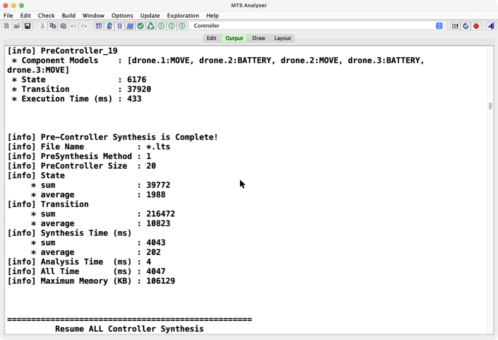
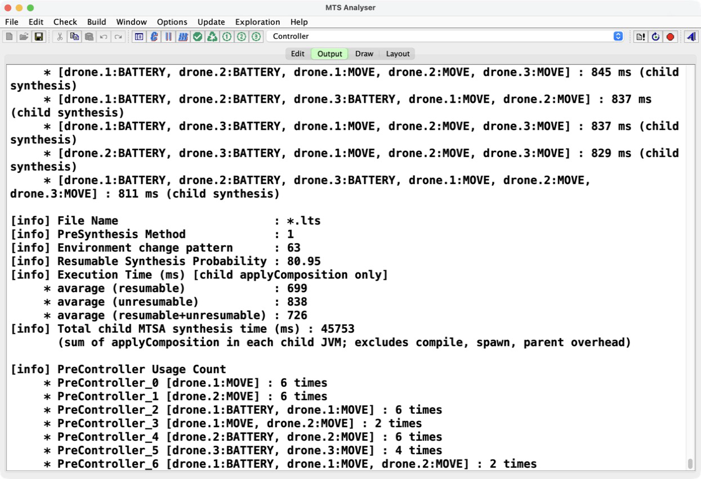
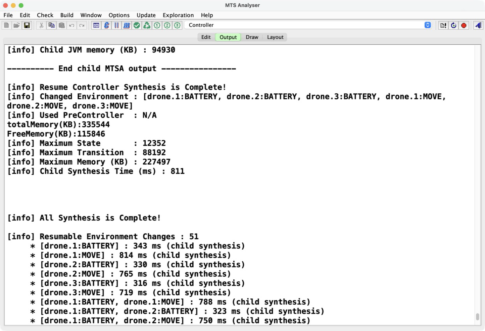

# DA-PCS

This repository contains the tool and benchmark models used in the DA-PCS paper.
The tool is an extension of MTSA (Modal Transition System Analyser), and the models are written in the MTSA `.lts` format.

## Repository layout

```
.
├── target/
│   └── mtsa-1.0-SNAPSHOT.jar   # MTSA extended with DA-PCS (download from Releases, see below)
└── model/
    ├── DC(2,K).lts             # Drone Control,     2 drones
    ├── DC(3,K).lts             # Drone Control,     3 drones
    ├── DC(4,K).lts             # Drone Control,     4 drones
    ├── HC（2,K）.lts            # Human Control, Hall + Room A
    ├── HC（3,K）.lts            # Human Control, Hall + Rooms A, B
    └── HC（4,K）.lts            # Human Control, Hall + Rooms A, B, C
```

## Requirements

- Java (JRE) to run the jar
- Enough main memory for the larger models. The command below allocates 20 GB of heap; change `-Xmx20G` to suit your machine.

## Downloading the tool

The jar (about 640 MB) exceeds GitHub's file size limit, so it is not stored in the repository itself. Download it from the [Releases](https://github.com/shunsuke1217/DA-PCS/releases) page and place it under `target/`.

**From the browser:** open the [latest release](https://github.com/shunsuke1217/DA-PCS/releases/latest), download `mtsa-1.0-SNAPSHOT.jar` from *Assets*, and move it to `target/` in the cloned repository.

**From the command line** (run in the repository root):

```bash
mkdir -p target
curl -L -o target/mtsa-1.0-SNAPSHOT.jar \
  https://github.com/shunsuke1217/DA-PCS/releases/latest/download/mtsa-1.0-SNAPSHOT.jar
```

## Running the tool

From the repository root:

```bash
java -jar -Xmx20G ./target/mtsa-1.0-SNAPSHOT.jar
```

This launches the MTSA GUI. To run an experiment:

1. Choose **File → Open** and select one of the `.lts` files under `model/` (e.g. `model/DC(3,K).lts`). The model is shown in the editor.
2. If needed, edit the size constants in the editor to set `K` (see [Models](#models)), then save the file.
3. Click a numbered button in the toolbar to choose the synthesis method:

   | Button | Method                                  |
   |--------|-----------------------------------------|
   | **1**  | DA-PCS (proposed)                       |
   | **3**  | Exhaustive PCS (baseline)               |

   Select **1** to run DA-PCS and **3** to run Exhaustive PCS. The buttons are the circled numbers ①②③ to the left of the target drop-down in the toolbar.
4. The experiment starts as soon as the button is pressed; no further input is needed. The tool first runs pre-synthesis (synthesizing the PreControllers) and then re-synthesis for every possible environment change. Progress and results are printed in the **Output** tab, which opens automatically.
5. When the run finishes, scroll the Output tab to read the results:
   - The pre-synthesis summary follows the line `Pre-Controller Synthesis is Complete!`.
   - The re-synthesis summary follows the line `All Synthesis is Complete!`, at the end of the log.

See [Example: DC(3,2) with DA-PCS](#example-dc32-with-da-pcs) for what the output looks like.

## Models

Each model file name has the form `XX(n,K)`, where `n` is fixed by the file and `K` is the size parameter varied in the paper's evaluation.

### DC: Drone Control

`n` is the number of drones (`const N`). To change the model size `K`, edit the following constants in each DC file:

| Constant  | Location in file | Meaning                                      |
|-----------|------------------|----------------------------------------------|
| `MaxX`    | Environment      | Width of the grid (x-axis), minimum 2        |
| `MaxY`    | Environment      | Depth of the grid (y-axis), minimum 2        |
| `LIMIT_X` | Requirement      | x-coordinate the drones must not enter       |
| `LIMIT_Y` | Requirement      | y-coordinate the drones must not enter       |

Do **not** change `S` or `MaxH` (the maximum height). The collision requirements `P_NO_COLLISON_*` are written out for heights 1 and 2 only, so a different height no longer matches the paper's setting.

### HC: Headcount Control

`n` is the number of areas (the hall plus rooms A, B, ...). To change `K` in the paper, edit `N` at the top of each HC file:

```
const N = 6
```

`N` is the maximum number of visitors counted in each area.

## Example: DC(3,2) with DA-PCS

This example runs DA-PCS (button **1**) on `model/DC(3,K).lts` with the constants as they are in the file (`N = 3`, `MaxX = MaxY = LIMIT_X = LIMIT_Y = 2`), which is the DC (N, K) = (3, 2) setting.

Time and memory depend on the machine and the JVM settings. The run below was made on a Mac with `-Xmx20G`, while the paper's measurements were made on Windows 11 (Intel Core Ultra 9 285K, 128 GB). The numbers of PreControllers, states and transitions and the reuse rate do not depend on the machine, and they match the paper.

### Pre-synthesis



| Item                              | Value                     |
|-----------------------------------|---------------------------|
| Number of PreControllers          | 20                        |
| States                            | 39,772 total (1,988 avg.) |
| Transitions                       | 216,472 total (10,823 avg.) |
| Synthesis time                    | 4,043 ms total (202 ms avg.) |
| Dependency analysis time          | 4 ms                      |
| Total time                        | 4,047 ms                  |
| Maximum memory                    | 106,129 KB                |

### Re-synthesis



| Item                                               | Value     |
|----------------------------------------------------|-----------|
| Environment change patterns                        | 63        |
| Patterns with a reusable PreController             | 51        |
| Patterns without a reusable PreController          | 12        |
| Reuse rate (`Resumable Synthesis Probability`)     | 80.95 %   |
| Average time per re-synthesis, reusable            | 699 ms    |
| Average time per re-synthesis, non-reusable        | 838 ms    |
| Average time per re-synthesis, all patterns        | 726 ms    |
| Total re-synthesis time                            | 45,753 ms |

Re-synthesis times count only the synthesis (`applyComposition`) in each child MTSA process; compiling the model, starting the child JVM and the parent's own overhead are excluded.

Each re-synthesis also prints its own state count, transition count and memory. The screenshot below shows the end of the last re-synthesis, which happens when all six environment models change and no PreController can be reused, followed by the line `All Synthesis is Complete!`.


